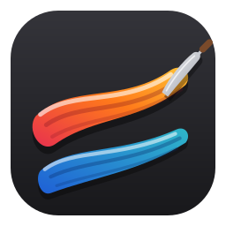
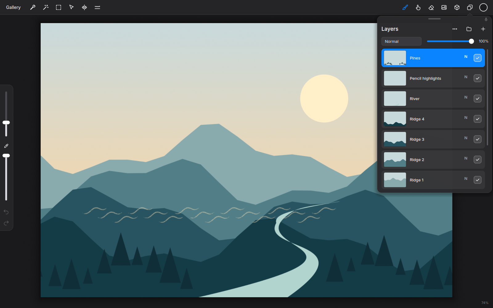
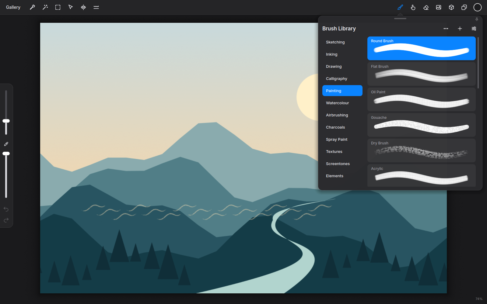
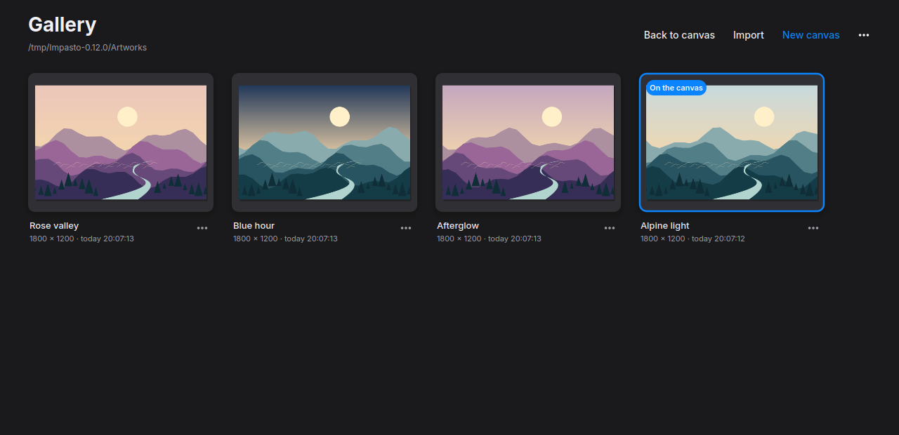

<h1 align="center">Impasto</h1>

Room to paint.

A painting studio for Linux and Windows. Responsive brushes, rich layers, and a canvas that stays yours.

<a href="https://github.com/ozzy-apps/impasto/releases/latest">Download Impasto</a> · <a href="docs/guide.md">Explore the tools</a> · <a href="mailto:impasto@ozzy.co.nl">Get in touch</a>

## From the first mark to the final frame

- **Feel every stroke.** 115 brushes, pressure and tilt support, and a Brush Lab for making your own.
- **Build in layers.** Masks, clipping, groups, and 26 blend modes, painted at 16 bits per channel on the GPU.
- **Find your line.** QuickShape, symmetry, perspective guides, selections, text, and liquify.
- **Bring it to life.** Frame-by-frame animation with onion skins, plus a posable 3D reference.
- **Keep creating anywhere.** Open and save Photoshop and OpenRaster files. Move your `.imp` artworks between Linux and Windows.

| Your brushes, within reach | Your work, together |
| --- | --- |
|  |  |

## Make yourself at home

**Version 0.12.0** brings Linux and Windows onto the same release.

| Platform | Download | Start painting |
| --- | --- | --- |
| Windows 10 / 11, 64-bit | [Installer](https://github.com/ozzy-apps/impasto/releases/download/v0.12.0/Impasto-0.12.0-windows-x64.exe) · [Portable ZIP](https://github.com/ozzy-apps/impasto/releases/download/v0.12.0/Impasto-0.12.0-windows-x64.zip) | Install, or extract the whole ZIP and open `impasto.exe`. |
| Ubuntu 24.04 / compatible, x86-64 | [DEB](https://github.com/ozzy-apps/impasto/releases/download/v0.12.0/impasto_0.12.0_amd64.deb) | Install with your package manager. |
| Linux, x86-64 | [AppImage](https://github.com/ozzy-apps/impasto/releases/download/v0.12.0/Impasto-0.12.0-x86_64.AppImage) · [Flatpak](https://github.com/ozzy-apps/impasto/releases/download/v0.12.0/Impasto-0.12.0.flatpak) | Make the AppImage executable, or install the Flatpak bundle. |

Requires OpenGL 4.3 and a current graphics driver. Packages are unsigned. Windows builds are checked under Wine; physical tablet and native Windows hardware checks remain. Artworks save to Pictures/Impasto; choose another folder from the gallery menu.

## Open by design

Built with **C++20, Qt 6, and OpenGL**. [MIT licensed](LICENSE).

[Build on Linux](docs/guide.md#build-and-run) · [Build on Windows](packaging/windows/BUILD.md) · [Report an issue](https://github.com/ozzy-apps/impasto/issues)

Made with love by Ozzy ❤️
