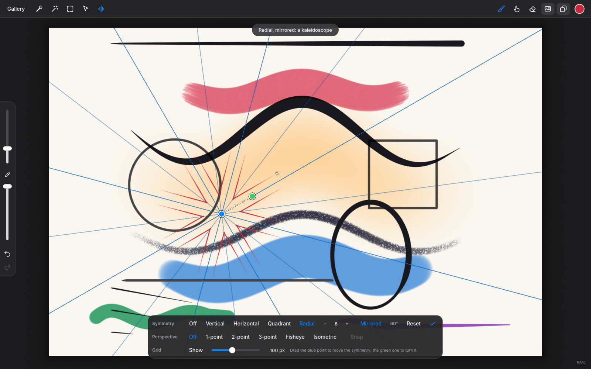
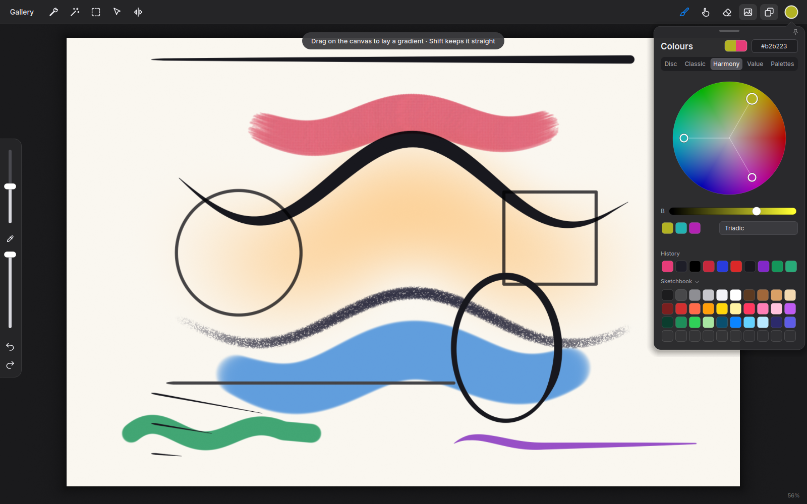
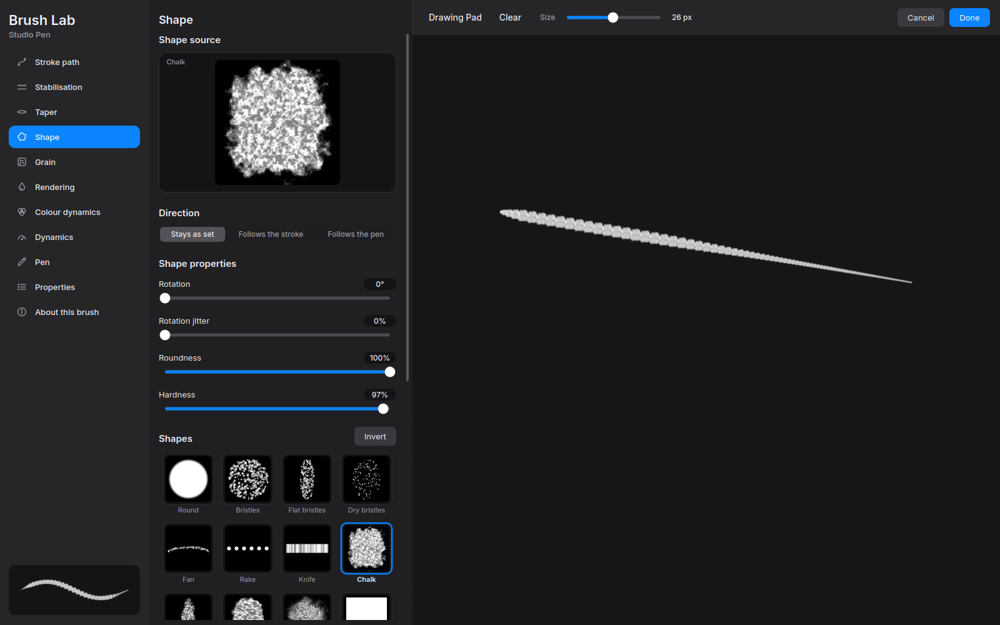
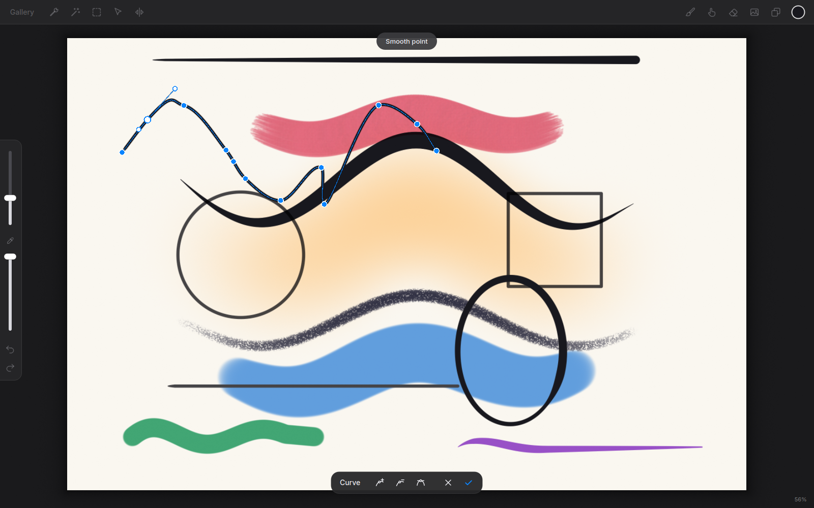
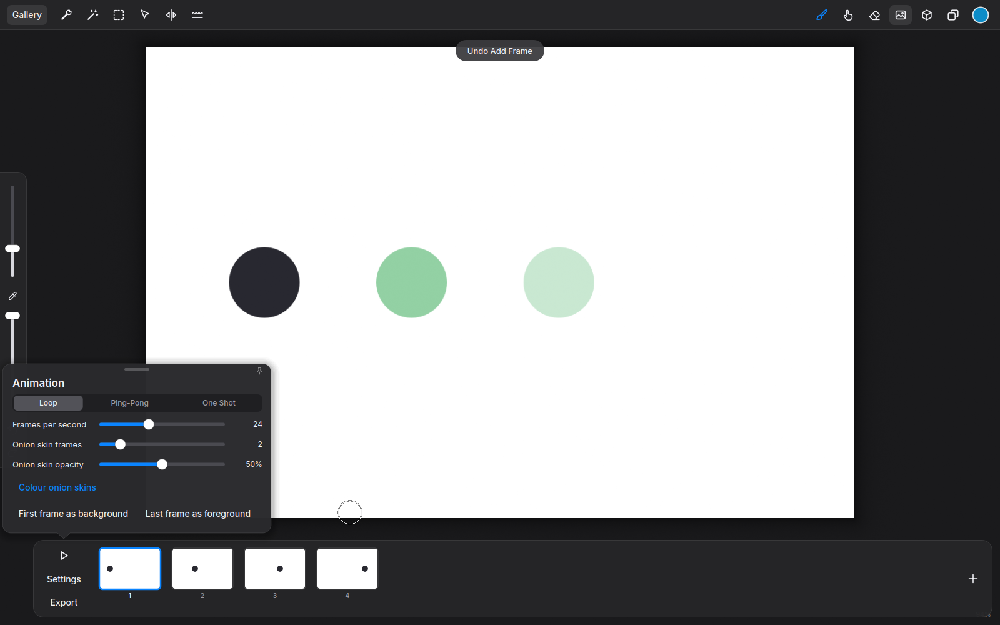
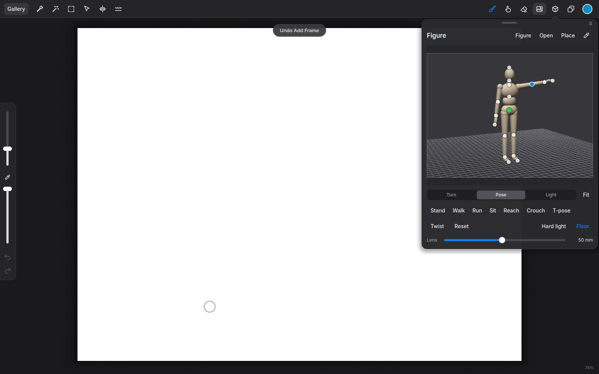
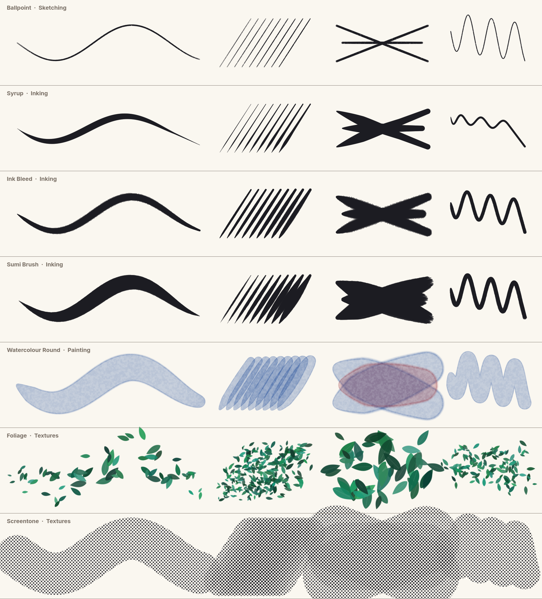

<p align="center"></p>

# Impasto

A painting app for pen tablets on the Linux desktop, in the spirit of Procreate:
a full-window canvas, brushes that answer to pressure and tilt, and tools that
stay out of the way until you want them. It paints on the graphics card at 16
bits a channel, opens and saves Photoshop and OpenRaster files, animates frame
by frame with onion skins, and keeps a posable 3D figure beside the canvas to
draw from.

| | |
| --- | --- |
|  |  |
|  |  |
|  |  |



## Install

Downloads are on the [releases page](https://github.com/ozzy-apps/impasto/releases).
Impasto needs OpenGL 4.3, which any graphics card or integrated graphics from
the last ten years offers.

- **Ubuntu 24.04 and what is built on it** (Zorin OS 18, Linux Mint 22,
  Pop!_OS 24.04): the `.deb`
  ```bash
  sudo apt install ./impasto_*_amd64.deb
  ```
- **Any distribution, through Flatpak**: the `.flatpak`
  ```bash
  flatpak install --user Impasto-*.flatpak
  ```
- **Any recent distribution, nothing to install**: the `.AppImage`
  ```bash
  chmod +x Impasto-*-x86_64.AppImage && ./Impasto-*-x86_64.AppImage
  ```

Artworks are kept in `~/Pictures/Impasto` unless you choose another folder in
the gallery. Documents are `.imp` files; brushes travel as `.impbrush` files.
(Before 0.9 the app was called Sketchbook: its `.sbk` documents and
`.sbkbrush` brushes open as they always did, and on its first start Impasto
takes over Sketchbook's settings, brushes and palettes.)

## Build and run

Needs a C++20 compiler, CMake, Ninja and the Qt 6 development packages
(6.4 or newer). On Ubuntu 24.04 and the distributions built on it:

```bash
sudo apt install cmake ninja-build qt6-base-dev qt6-svg-dev zlib1g-dev
```

```bash
cmake -S . -B build -G Ninja
cmake --build build
./build/impasto               # optionally pass an .imp, .psd, .ora or image file to open
```

To add it to the application menu for your user:

```bash
cmake --install build --prefix ~/.local
```

The three packages are made by `packaging/build-packages.sh` (see the top of
that script for what it needs).

## What it does

- **Canvas**: 16-bit float layers composited on the GPU, pan / zoom / rotate /
  mirror the view. A layer takes graphics memory only where there is paint on
  it: an empty layer costs nothing, a layer of line work a little, a layer
  filled edge to edge 8 bytes a pixel. How large a canvas may be follows from
  the graphics card: up to its largest texture on a side (32,768 px on
  current cards) and as many megapixels as leave room, beside the finished
  picture, for about three layers' worth of paint. On an 8 GB card that is
  about 185 megapixels: 13,594 px square, or 115 cm square at 300 dpi; a
  metre square at 300 dpi (139 megapixels) has room for about three layers
  filled edge to edge, and many more with less on them. *New Canvas* takes a
  size in pixels or as a size on paper (mm, cm, inches) at a resolution, with
  sheets up to A1 and the largest square the card holds among its presets;
  it says how many pixels and megapixels that comes to and how much paint
  there is room for, and when a sheet is too large, the finest resolution at
  which it would fit. The resolution is kept with the document and written
  into exported pictures. When memory does run short, the working copies kept
  for speed go first, then the oldest undo steps (with a notice), and paint
  that still does not fit is refused with the reason rather than lost.
- **Brushes**: 119 presets in fourteen sets: sketching, inking, drawing,
  calligraphy, painting, watercolour, airbrushing, charcoals, spray paint,
  textures, screentones, elements (grass, fur, clouds, smoke, rain, snow),
  luminance and abstract. They are made of 30 tip shapes and 21 grains, all
  worked out at start-up, so nothing binary ships. Pressure and tilt
  dynamics, StreamLine stabilisation, shaped tips, paper grain, wet edges,
  colour jitter. Paint, smudge and erase each remember their own brush, size
  and opacity. Rest on a brush in the library for a moment to pick it up and
  put it elsewhere in its set.
- **Blend modes and wet brushes**: a brush can have a blend mode of its own
  (Multiply for markers and washes, Add and Screen for light), which decides
  how its paint meets what is already on the layer. A wet brush drags that
  paint along and mixes it into its own: *Pull* is how far, *Charge* how much
  of its own paint a pass leaves. Wet Oil, Wet Acrylic, Blender and Wet in Wet
  are set up that way.
- **Colours**: five pages in one panel. *Disc* and *Classic* (a square of
  saturation and brightness) choose a colour by eye. *Harmony* shows the
  colours that go with it on a wheel (complementary, split complementary,
  analogous, triadic or tetradic); drag any mark and the set turns together,
  tap a chip to take that colour. *Value* gives hue, saturation, brightness,
  red, green and blue as sliders and as numbers. The colours used lately and
  the default palette stay underneath, and `X` swaps the current colour with
  the previous one.
- **Palettes**: sets of colours of your own, ten to a row. Tap an empty slot
  to keep the current colour there; rest on a swatch to pick it up, then drag
  it to another slot (two swatches change places) or let go to replace or
  remove it. The *Palettes* page lists them all: make one empty, from what is
  on the canvas, from the reference picture or from any picture file; rename,
  duplicate, delete; tap a name to choose which one stays under the pickers.
  Carry a swatch from one palette onto another in the list and a copy goes
  in there (into the next free slot if the one under the pen is taken).
  Procreate palettes (`.swatches`), GIMP palettes (`.gpl`), lists of hex codes
  and Adobe swatch files (`.ase`) import; a palette exports as `.swatches` or
  `.gpl`.
- **QuickShape**: rest the pen at the end of a stroke and it snaps to a clean
  line, arc, smooth curve, circle, ellipse, rectangle, square, triangle, polygon or polyline,
  redrawn with the same brush and the line weight you drew it with. Keep the pen down to resize and turn it; after
  lifting, tapping the line (or *Edit Shape* at the top) reopens it with
  handles that snap to a perfect circle or square. Any shape can also be
  worked on point by point: `Ctrl` + click on the line puts a point there
  without moving the line (keep the button down and it comes along), `Ctrl` +
  click on a point takes it out, `Alt` + click changes a point between a
  smooth one and a sharp corner. A smooth point that has been chosen shows a
  handle either side of it for shaping the bend. The edit bar has the same
  three as buttons, for a pen with no keyboard beside it, and a fourth that
  joins the two ends of an open shape or cuts a closed one open at the chosen
  point. Cut open, the line stays exactly where it was, with its two ends
  lying together to be pulled apart.
- **Selections**: automatic (tap an area to select it by colour), freehand,
  rectangle and ellipse, added to or cut from each other, feathered, inverted,
  moved with the transform tool. While something is selected, painting,
  erasing, smudging, fills, clearing and adjustments stay inside it, fading
  out across a soft edge. A layer's contents can be turned into a selection.
  The selection is saved with the document and is still there when it is
  opened again.
- **Fill**: drag the colour chip onto the canvas (or press `G` and tap) to
  flood an area of similar colour, with a softened rim so it meets line work
  cleanly. Slide sideways before lifting the pen to change how far the colour
  spreads; the fill follows as you go.
- **Reference layer**: mark the layer holding your line art as the reference
  and fills and automatic selections on every other layer stop at its lines.
  A group can be the reference too, when the lines are on several layers:
  then everything in it counts, and a fill on a layer inside the group stops
  at the lines of the others.
  The colour carries on a few pixels underneath them, so no pale fringe is
  left between colour and line.
- **Copy, cut, paste**: the selected pixels of a layer; pasting adds a layer in
  place, ready to move. Images from other apps paste too.
- **Brush Lab**: the sliders icon in the brush library opens the current
  brush over the whole window. Its settings are sorted into sections down the
  left (stroke path, stabilisation, taper, shape, grain, rendering, colour
  dynamics, dynamics, pen, properties, about); the middle holds the open
  section, with a pressure curve of the brush's own to drag into shape and
  large pictures of every tip shape and grain to pick from; the rest is a
  drawing pad. Whatever is drawn on the pad is drawn again each time a
  setting changes, so the same strokes show what the change did. Changes
  apply at once and are kept between sessions; *Cancel* puts the brush back
  as it was when the lab opened, and *Reset* restores a shipped brush.
- **Your own brushes**: *+* in the brush library starts a brush from scratch,
  *Duplicate* copies any brush into one that is yours to rename, reshape, move
  to a set of your own and delete. Any image can be imported as a tip shape or
  as a paper grain. A brush exports to a single `.impbrush` file, imported
  shapes included, and imports the same way.
- **Gallery**: the *Gallery* button shows your artworks as a wall of
  thumbnails: everything in the gallery folder (`~/Pictures/Impasto` unless
  you choose another) plus documents recently opened from elsewhere. Tap one to
  open it; rename, duplicate, or move to the trash from its menu. Saving an
  untitled canvas puts it there without asking for a name first.
- **Smoothing and line weight**, per brush in the Brush Lab: StreamLine,
  stabilisation (running average), pull string, weight smoothing, start and end
  taper, taper tip, speed weighting. Preferences adds stabilisation for all
  brushes and an editable pen pressure curve.
- **Stabilisation at hand** (`Y`): the wavy-line button at the top left opens
  a small panel with the four smoothing settings of the brush in hand
  (StreamLine, stabilisation, pull string, weight smoothing) and the
  smoothing added to all brushes, without going into the Brush Lab. It
  follows whichever brush the current tool holds, changes it the way the Brush
  Lab would, and can be pinned open beside the canvas like the other panels.
- **Layers**: add, duplicate, delete, drag to reorder, rename, merge down,
  opacity, 26 blend modes, alpha lock, clipping masks, fill, clear, flip, plus a
  background colour that can be hidden for transparent artwork.
- **Layer masks**: hide parts of a layer without erasing them. Click the mask's
  thumbnail to paint on it with any brush (black hides, white reveals, the
  eraser reveals); click the layer's thumbnail to go back. A mask can start
  from the current selection, be inverted, switched off, baked in or deleted,
  and it moves with its layer under Transform.
- **Layer groups**: folders that nest up to four deep, with their own opacity,
  blend mode and visibility, blended as one unit. Drag layers in and out (how
  far right you drop decides the level), fold a group shut, duplicate, ungroup,
  or flatten it into a single layer. A group can have a mask of its own, which
  hides part of everything in it and is painted on like any other mask;
  flattening the group keeps the mask on the layer it becomes.
- **Symmetry and grid**: the mirror button in the top bar opens a bar with
  vertical, horizontal, quadrant and radial (2 to 24-fold) symmetry, and a
  grid with adjustable spacing. Symmetry starts about the middle of the
  canvas, upright; while the bar is open, drag its blue point to put it
  anywhere and its green point to turn it. *Rotational* turns the repeats
  about the centre instead of mirroring them, and *Mirrored* makes radial
  symmetry a kaleidoscope. Brush, smudge, eraser and QuickShape strokes are
  repeated as you draw; the guides are saved with the document, stay on the
  picture when the canvas is cropped, resized or flipped, and are never part
  of it.
- **Perspective guides**: in the same bar, one-, two- and three-point
  perspective with vanishing points you drag into place (off the canvas too),
  five-point fisheye with a movable, resizable circle, and isometric with the
  two receding angles set by sliders. With *Snap* on, a stroke keeps to
  whichever guide line it sets off along; in fisheye that includes the bent
  horizontals and verticals. Where two lines leave a point at nearly the same
  angle, the choice waits until the pen has gone far enough to show which is
  meant.
- **Adjustments and filters** (the wand): hue / saturation / brightness,
  brightness and contrast, colour balance, levels, curves (all channels or
  red, green, blue separately), black and white, invert, posterize, threshold,
  Gaussian blur, sharpen, noise and mosaic. Levels and curves show the
  layer's histogram. Each previews live on the active
  layer, keeps to the selection if there is one, and is one undo step.
- **Made for the pen**: every list scrolls by pressing on it and dragging, and
  a flick glides on. In a layer list longer than its panel, rest on a layer
  for a moment to pick it up, then drag it; carried to the edge, the list
  scrolls along.
- **Panels that stay open**: drag a panel away by its top edge (or press its
  pin) and it floats where you leave it, open while you paint, snapping to
  the window's edges. Its button in the top bar hides and shows it; the pin
  sends it back under its button. Which panels are pinned, and where, is
  remembered.
- **Editing**: transform (move, scale, rotate, flip, fit; *Distort*, which
  frees the four corners to put a layer into perspective; and *Warp*, a sheet
  of sixteen points that bends the layer wherever one is pulled), flip
  canvas, insert image.
- **Liquify** (`W`): push, twirl either way, pinch, expand and restore, with
  a brush from 20 to 5000 px (`Shift` + drag sizes it), a strength, and pen
  pressure for how much. It runs on the graphics card: on a 4K canvas a touch
  of a 600 px brush takes a third of a millisecond, of a 5000 px brush about
  two. Nothing is changed until it is applied.
- **Reference picture** (`R`): a panel holding an image to draw from. Open a
  file, paste, or drop one in; drag to pan, zoom with the slider or the
  wheel, flip it, and pick colours from it with its eyedropper (or `Alt`, or
  right-click). *Remove* takes it away again. Like the other panels it can be torn off and left open while
  you paint. It is never part of the artwork.
- **Gradient** (`Shift+G`): drag on the canvas to lay a linear, radial,
  angle (sweeping anticlockwise round the start point, as in Photoshop), reflected (mirrored either
  side of the start) or diamond gradient from the current colour to nothing, to the previous colour, or
  through *Colours* of your own: a strip in the bar holds them, a press on it
  adds the current colour, a handle is dragged along or pulled away to remove
  it, and *Fade* makes one transparent. *Presets* has nine ready-made
  gradients and keeps your own. It respects the selection and alpha lock.
- **Text** (`T`): tap the canvas and type; the text appears where it will
  be, in the current colour. A bar at the bottom sets the font, size, bold,
  italic, alignment, letter spacing and line spacing as you go, and pressing on the canvas again drags the
  text about. When done it becomes a layer of its own, inside the transform
  box in case it should be sized or turned. It stays text: tap it again with
  the text tool (or *Edit Text* on its layer) to change the words, the font
  or the colour. Moving, sizing and turning it keep it text, and sharp;
  painting on it, erasing or filtering it makes it ordinary pixels, and undo
  makes it text again.
- **Animation Assist** (the wrench menu): every top-level layer or group is a
  frame, as in Procreate. A timeline along the bottom shows them in a row: tap
  one to work on it, tap it again for its options (hold it for longer,
  duplicate, delete), rest on one and drag to move it, and *+* adds the next.
  The frames either side show faded behind the one you are drawing, earlier
  ones in red and later ones in green, as many as you like. *Settings* has
  loop, ping-pong or one-shot playback at 1 to 60 frames a second, and can keep
  the first frame as a background and the last as a foreground. *Export* writes
  an animated GIF (one palette for every frame, so nothing flickers), an
  animated PNG (every colour, see-through parts kept), an MP4 video (when
  ffmpeg is installed) or a numbered PNG for every frame, at full size, half
  or 1080 px. It is all kept in the document.
- **3D reference** (`Shift+R`, the cube at the top): a figure to pose and draw
  from, beside the canvas, in the manner of Clip Studio's 3D figures. The
  built-in jointed figure comes with poses (stand, walk, run, sit, reach,
  crouch, T-pose); in *Pose*, drag any joint and the limb above it follows,
  *Twist* turns a bone about itself, and the hips move the whole figure. Open
  a model of your own (glTF and GLB, rigged ones posable by their joints
  too, OBJ, STL). A person that came without joints, as models from AI
  generators and scans usually do, can be rigged in Impasto: *Rig* fits the
  figure's skeleton into it from its shape (standing, arms out or down),
  shows the joints to be checked from the front and the side (a joint moved
  moves its twin on the other side), and *Bind* ties the surface to the
  bones, blended where they meet. It then poses like the figure, named poses
  included, and opens rigged the next time. *Figures* lists the people to
  choose from: the mannequin, a woman that comes with Impasto, and any rigged
  model kept with *Keep*, which stays among them for good. *Turn* goes round it, *Light* moves the light, *Hard light*
  shows it in two tones (the light and shadow shapes), and the lens goes from
  14 mm (strong perspective) to 200 mm (flat). A dashed frame shows what will
  land on the canvas: *Place* puts the model there as a layer of its own to
  draw over, and the eyedropper picks colours from it. The model, its pose,
  the view and the light are kept between sessions.
- **Crash recovery**: unsaved work is copied aside every couple of minutes
  while the pen rests. If the app or the computer goes down, the next start
  offers it back.
- **Canvas size**: *Crop or Extend Canvas* puts a frame with handles over the
  canvas; pull it in to crop, out past the edge to add room, or type a size.
  *Resize Image* scales the whole picture to a new pixel size. Every layer and
  mask follows, guides stay where they were on the picture, and either is one
  undo step.
- **Undo**: up to 250 steps within a 1.5 GB budget, stored on the GPU as the
  256 px tiles each stroke touched.
- **Files**: native `.imp` documents keep every layer at full precision;
  export PNG, JPEG or WebP; open images as a new canvas. Save, Save As and
  Export are in the wrench menu.
- **Photoshop and OpenRaster**: Export also writes layered files for other
  programs, and Open reads them as a new untitled canvas. PSD (8 or 16 bits a
  channel, PSB when a side is past 30,000 px) keeps layer names, order,
  groups, visibility, opacity, all 26 blend modes, masks, clipping and alpha
  lock, with the resolution and an sRGB colour profile. OpenRaster (`.ora`:
  Krita, GIMP, MyPaint) keeps the same except masks and clipping, which it has
  no room for: they are baked into the layers' pixels (a group with a mask
  goes as the one layer it shows), and the notice after exporting says so. The paper goes out as a "Background" layer and comes back
  as paper. Text goes as pixels either way. Opening a PSD leaves out
  adjustment and fill layers and layer effects, takes smart objects and text
  as their pixels, and treats Pass Through groups as ordinary ones; it says
  which of these it met. CMYK, Lab and 32-bit PSD files are refused. Checked
  against Krita: it reads Impasto's files to within 1/255 of what Impasto
  shows, except that Krita's PSD import ignores clipping and group opacity
  (in its own PSD files too), so for Krita, OpenRaster is the better choice.
  Files Krita writes open in Impasto to within 1/255.

## Controls

| Action | Input |
| --- | --- |
| Paint / Smudge / Erase | `B` / `S` / `E` (click the active tool again for the brush library) |
| Brush Lab | the sliders icon in the brush library (`Esc` or *Done* keeps the changes, *Cancel* drops them) |
| Keyboard shortcuts | the wrench menu: a window of its own that can stay open; press a heading to fold it |
| Brush size | `[` `]`, `Alt` + scroll, `Shift` + drag sideways (in Liquify: its brush), or the upper sidebar slider |
| Opacity | `{` `}`, or the lower sidebar slider |
| Eyedropper | hold `Alt`, right-click / pen barrel button, or `I` |
| Undo / Redo | `Ctrl+Z` / `Ctrl+Shift+Z` |
| Pan | `Space` + drag, or middle-drag |
| Zoom | scroll, `Ctrl+Space` + drag, `Ctrl` `+` / `-` |
| Rotate view | `Shift+Space` + drag, `4` / `6`, `5` resets |
| Fit / 100% / mirror view | `Ctrl+0` / `Ctrl+1` / `M` |
| Layers / Colours / Reference picture | `L` / `C` / `R` |
| 3D reference | `Shift+R`, or the cube at the top |
| Animation Assist | the wrench menu; the timeline's Play, Settings and Export |
| Stabilisation of the brush in hand | `Y`, or the wavy-line button at the top left |
| Swap the current and the previous colour | `X`, or tap the pair of chips at the top of Colours |
| Keep a colour in the palette | tap an empty slot |
| Move, replace or remove a swatch | rest on it for a moment, then drag it, or let go for its menu (the mouse drags at once; right-click for the menu) |
| Choose the default palette | tap its name on the *Palettes* page, or the palette's name under the pickers |
| New / duplicate / merge down layer | `Ctrl+Shift+N` / `Ctrl+J` / `Ctrl+E` |
| Group / ungroup | `Ctrl+G` / `Ctrl+Shift+G` |
| Clear layer | `Delete` |
| Transform | `Ctrl+T` (`Enter` applies, `Esc` cancels, `Shift` toggles proportions) |
| Crop or extend the canvas / resize the image | the wrench menu (`Enter` applies, `Esc` cancels) |
| Distort | `Ctrl+T`, then *Distort*: drag a corner, a side or the whole |
| Warp | `Ctrl+T`, then *Warp*: drag any point of the sheet |
| Liquify | `W`; pick what the pen does in the bar |
| Gradient | `Shift+G`, then drag (`Shift` keeps it straight); *Colours* for more than two |
| Text | `T`, tap the canvas, type; `Ctrl+Enter` when done, `Esc` to cancel |
| Change text that is already placed | `T`, then tap the text; or *Edit Text* in its layer's menu |
| Move a brush within its set | rest on it for a moment, then drag (the mouse drags at once) |
| Hue, Saturation, Brightness | `Ctrl+U` |
| Select an area | `Q`, then drag; `Alt` + drag removes |
| Automatic selection | `Q`, *Automatic*, then tap an area; slide sideways for the threshold |
| Feather a selection | `Q`, *Feather*, then the slider |
| Select all / deselect / invert | `Ctrl+A` / `Ctrl+D` / `Ctrl+Shift+I` |
| Copy / cut / paste | `Ctrl+C` / `Ctrl+X` / `Ctrl+V` |
| Fill | drag the colour chip onto the canvas, or `G` then tap |
| Fill threshold | slide sideways before lifting; with the chip, rest it on the canvas first (`Esc` cancels) |
| Reference layer | right-click the line-art layer, *Reference* |
| QuickShape | draw, then hold the pen still for about half a second |
| Resize / turn the snapped shape | keep the pen down and drag |
| Perfect circle, square, 15° line | hold `Shift` while shaping, or use the *Circle* / *Square* buttons |
| Shape handles without snapping | hold `Alt` |
| Add a point to a shape | `Ctrl` + click its line, or the bar's *add point* button and then the line |
| Remove a point | `Ctrl` + click it; `Delete` removes the chosen one |
| Smooth point / sharp corner | `Alt` + click the point |
| Shape the bend at a smooth point | click the point, then drag one of its two handles |
| Reopen the last shape | tap its line, or click *Edit …* at the top (`Enter` applies, `Esc` cancels) |
| Hide interface / fullscreen | `Tab` / `F11` |
| New / open / save / save as / export (picture, PSD, OpenRaster) | `Ctrl+N` / `Ctrl+O` / `Ctrl+S` / `Ctrl+Shift+S` / `Ctrl+Shift+E` |
| Gallery | the *Gallery* button; `Esc` or *Back to canvas* returns |
| Symmetry / perspective / grid | the mirror button in the top bar; drag the coloured points while its bar is open |
| Move / turn the symmetry | drag its blue point / its green point (`Shift` turns in steps of 15°); *Reset* puts it back |
| Levels / Curves | `Ctrl+L` / `Ctrl+M`; the other adjustments are under the wand |
| Scroll a list with the pen | press and drag it; flick to glide |
| Move a layer in a long list (pen) | rest on it for a moment, then drag |
| Keep a panel open | drag it away by its top edge, or press its pin |
| Artwork menu (rename, duplicate, trash) | the dots under a thumbnail, or right-click it |
| New brush / brush menu | *+* and the dots in the brush library; right-click a brush |

Right-click a layer for its actions (masks, groups, *Reference* and *Select
Contents* are there too); double-click to rename it. QuickShape's rest time
and the fill threshold are under the wrench menu, in Preferences.

## How it is put together

```
src/gfx      thin OpenGL helpers (textures, shader programs, fullscreen pass)
src/brush    presets, procedural and imported tips and grains, stroke engine, dab renderer
src/color    palettes (kept, read, written, taken from a picture) and colour harmonies
src/shape    QuickShape: stroke recognition and shape geometry
src/model    3D models: glTF/GLB, OBJ and STL, the jointed figure, posing
src/engine   CanvasEngine: document, layers, compositing, undo, edits
src/io       .imp load/save, image export, PSD/PSB and OpenRaster (with a small zip reader and writer), animated GIF and PNG
src/ui       viewport, panels, gallery, main window
resources    GLSL shaders and the app icon
```

`CanvasEngine` owns everything on the GPU in its own OpenGL context; the
viewport only samples the composited result, so painting, undo, file I/O and
brush previews never depend on the widget tree.

The layer stack is a flat list, bottom to top. A group is a header entry whose
members sit directly below it and name it as their parent. Compositing walks
that as a tree: each group is blended on its own over transparency, in a pair
of buffers belonging to its nesting level, and the result then takes the
group's opacity and blend mode in the level above. A mask is stored like a
layer (opaque greyscale), which is why brushes, fills and undo work on it
without special cases. Structural edits (add, move, group, delete) are undone
by restoring a snapshot of the order and parents.

Layers live in sparse textures (`GL_ARB_sparse_texture`): to every shader a
layer is a texture the size of the canvas, but the card only sets memory aside
for the 256 px blocks that have been asked for, and a block nobody asked for
reads as nothing. `gfx::Texture` keeps the map of blocks. A draw into a sparse
target brings memory for what its scissor rectangle can reach
(`gfx::beforeDraw`); passes that know better say so themselves: a stroke asks
for the blocks its dabs land on, a merge for the blocks where the layer or the
stroke has something, and an edit for the part of the canvas its result can
occupy. Copies between textures carry "nothing here" across as nothing. Undo
keeps a changed tile, or the fact that it was empty, so undoing a stroke also
gives back the memory it took; whole-layer edits are followed by a pass that
finds the blocks left empty (one fragment per block, on the card) and lets
them go. The buffers a stroke passes through are sparse too on canvases large
enough for their size to matter, and whole on smaller ones, where handing out
memory block by block would only cost time. What stays the size of the canvas
is the finished picture with its mipmaps, the selection, and layer masks.

Handing a block its memory costs time (about a quarter of a millisecond on
the card this was measured on), paid once: the first stroke over a fresh
stretch of a layer takes a little longer to settle when the pen lifts, and on
a very large canvas a stroke or a growing QuickShape pays it as it goes. On an
8 GB card a canvas of 139 megapixels takes strokes at 1.5 to 2 ms a sample.

The canvas is composited a band at a time (2048 px), in buffers the size of a
band, so what compositing needs does not grow with the canvas; the shader is
told where each texture's origin lies. A card without sparse textures, or
`IMPASTO_NO_SPARSE=1` in the environment, stores every layer whole, with the lower
limits that go with that. `--selftest` draws one scripted canvas through 44
steps (strokes, fills, gradients, transforms, filters, masks, groups, flips,
resizes, undo, redo, a file round trip) under each kind of storage and
compares pictures and layers to the bit.

The selection is an 8-bit image the size of the canvas, mirrored in a texture,
so a soft edge is just in-between values and everything that honours the
selection does so in proportion. Shapes are rasterised into it, the wand
floods into it, and feathering is a Gaussian blur on the GPU. The outline is
drawn by the shader that presents the canvas, along the contour where the
selection is one half, so it costs the same however intricate the selection is.

A fill or automatic selection starts with one GPU pass that measures every
pixel's distance from the colour under the pen, on the active layer and on the
reference layer. A scanline flood on the CPU then only compares bytes against
the threshold, which is what makes it quick enough to redo while the threshold
is being dragged.

A stroke works like this:

1. `StrokeEngine` stabilises the pen samples, fits a centripetal Catmull-Rom
   spline and emits dabs at even arc-length steps with the preset's dynamics.
2. `DabRenderer` draws them as instanced quads into a stroke buffer with two
   attachments: paint (dab over dab) and outline coverage (maximum), so hard
   brushes keep a clean antialiased edge however many dabs overlap.
3. `merge.frag` combines stroke and layer, applying stroke opacity as a glaze,
   canvas-fixed grain, eraser mode and alpha lock.
4. Only the dirty rectangle is recomposited. When the pen lifts, the touched
   tiles are saved for undo and copied into the layer.

The UI run feeds pen events in at the window, the way the platform does, so it
covers Qt's own routing: picking the widget under the pen, offering an
unhandled press to each parent, and replaying it as a mouse event. Sending
events straight to a widget skips all of that and once hid a bug where the pen
could open a panel but not use it.

Symmetry is a short list of operations about one centre: a turn by an angle,
or a mirror image in a line at an angle. Vertical is one mirror, Quadrant two
mirrors and a half turn, Radial a turn for every repeat, and a kaleidoscope
adds a mirror for every spoke and every gap between two. Each dab the stroke
engine emits is put through every operation before it is drawn, which is why
the eraser and QuickShape needed nothing of their own. Smudging does: every
repeat is a smear that remembers for itself where it last was.

The Brush Lab's drawing pad is a second `CanvasEngine` with a viewport of
its own, so a brush behaves on it exactly as it does on the canvas. That
engine keeps a journal of the strokes made on it, as the pen made them; when
a setting changes it wipes its one layer and plays the journal back with the
brush as it now is.

Every state a layer's pixels are ever in has a number, and undo and redo bring
the number back with the pixels. What was typed is kept under that number,
which is all it takes for a layer to know that it is, once more, exactly its
text: no command has to say so, and anything that changes the pixels ends it.

A wet brush runs through the smudge path instead of the stroke buffer: each
dab moves what lies a step behind it forward, then lays the brush's own
colour over that, a share of it sized so that one pass leaves the charge.

A palette taken from a picture starts from pixels sampled on an even grid.
They are split into groups in Oklab, where distances match how different two
colours look: whichever group varies most is cut in two at its mean, with hue
and saturation counted double so that a picture's lights and darks do not use
up every swatch. Each group is then shown by the pixel nearest its mean, so a
swatch is always a colour the picture really has, never a blend, and colours
too much alike are merged.

QuickShape builds on the same path. `QuickShape::recognize` resamples the
stroke, decides whether it is open or closed, and compares fits (line, circle
arc, ellipse, corner polygon with sides re-fitted and intersected). The engine
then discards the dabs drawn so far and runs the brush along the shape's
outline. The pressure, tilt and speed recorded along the stroke are replayed
along the outline by arc length (starting where the stroke started, in the same
direction), so the shape keeps the stroke's swelling and thinning. The same
random seed is reused, so it re-renders identically while it is resized or
edited. A shape is one undo
step however often it was adjusted.

While a snapped shape is resized or a handle is dragged, the redraw happens
once per frame with the pen's newest position, not once per pen report (a
tablet sends a couple of hundred a second), and only the part of the stroke
buffer the previous version touched is cleared. Redrawing a shape that spans
an 8000 px canvas takes about 5 ms, nearly all of it the graphics card
drawing the brush along the outline.

Editing point by point turns the shape into a path (`QuickShape::Kind::Path`):
points in order, each a corner or a smooth point, joined by cubic Bezier runs.
A smooth point's handles are not stored as positions but as how they differ
from the ones its neighbours would give it (the tangent of the centripetal
spline a Curve is drawn with), as a turn and a stretch. Left alone that
difference is nothing, so a recognised curve becomes a path without changing;
moving a neighbour bends the handles along; and a point can be put on a run by
splitting it exactly, with the differences worked out so that the line stays
where it is. Taking a point out is the reverse split.

## Checks

The binary can exercise itself without a window on screen:

```bash
./build/impasto --selftest out.png      # engine, undo, layer ops, save/load, selections, fills, masks, groups, gradients, text, shapes, brushes, palettes, layer storage
./build/impasto --ui-shot shots/ui      # the real UI driven by a simulated pen and mouse
./build/impasto --brush-sheet sheet.png # every brush preview
./build/impasto --brush-showcase out.png [brush-id ...]   # strokes at working size on paper
./build/impasto --bench                 # stroke, shape, fill and selection cost at 1440p, 4K and 8K
./build/impasto --bench 8000x8000       # the same for one size of your choosing
IMPASTO_NO_SPARSE=1 ./build/impasto         # store every layer whole, as on a card without sparse textures
IMPASTO_ONLY=animation ./build/impasto --selftest out.png   # one group of checks only: gaps, animation or model (also for --ui-shot)
./build/impasto --interchange-sample dir # a test document written as .ora and 8- and 16-bit .psd, with its picture
./build/impasto --interchange-open file.psd out.png   # open a PSD or .ora as Impasto would; print its layers
tools/krita-headless.sh dir --export --export-filename dir/out.png dir/in.psd   # Krita's reading of a file, without touching your Krita
./build/impasto --rig-check model.obj out   # rig a model as Rig would; renders it fitted and in a few poses
./build/impasto --devices               # pointing devices Qt sees, with pressure/tilt
```

Both runs keep to throwaway folders of their own: they never read or write
your settings, brushes or gallery.

## Not there yet

Canvases beyond what the finished picture itself fits in (it, the selection
and every layer mask are still whole canvases in graphics memory, which is
what sets the limit now), opening a large document without unpacking all its
layers in main memory first, adjustment layers, QuickShape recognising
strokes that mix corners with bends (they can be made by hand now, point by
point), text that stays editable in PSD files, CMYK and 32-bit PSD, Procreate's own
`.procreate` files, importing other apps' brush formats, and Wayland-specific
testing.

## Licence

MIT: see [LICENSE](LICENSE). Impasto uses Qt (LGPL-3.0) and zlib, linked as
shared libraries; the AppImage and the Flatpak carry their own copies of them.
